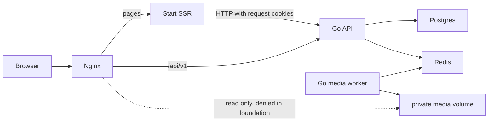

# Containers

API and worker are separate executables of one backend module. Only Nginx publishes a host port in base Compose. Health/metrics ports and data stores remain internal. A one-shot migrator runs Goose after PostgreSQL is healthy. An explicit seed command adds demo records after migrations. Monitoring is an optional Prometheus profile.

Local HTTP is for development. TLS termination, secret injection, backups and restore drills are deployment responsibilities before public exposure.
